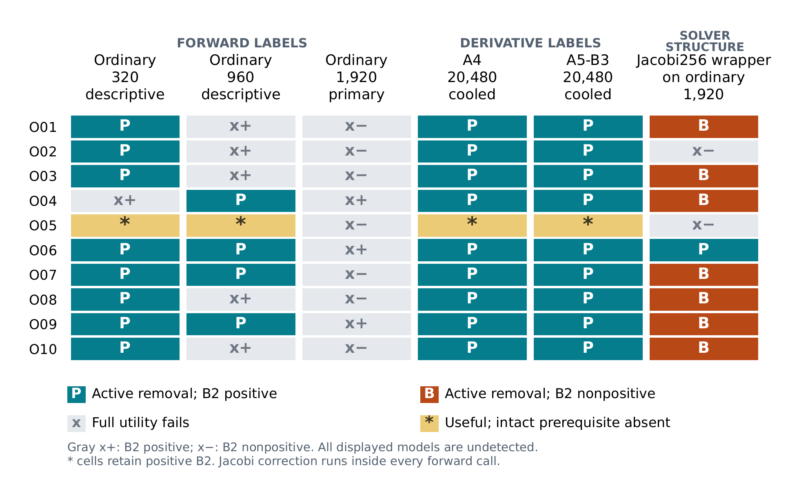

# OperatorMark

**Can a useful copy lose the evidence of where it came from?**

I built OperatorMark to investigate that question for neural PDE operators. The test has two parts: does an ownership signal survive an attack, and does the resulting model still do the job? Losing a watermark alone is not enough to call an attack successful.

The study follows ten independently trained Fourier neural operators on a discrete Darcy-flow benchmark. It tests an **active tangent-space watermark** and a **passive tangent-distance ranking (B2)** against modified copies of those models.

**[Read the paper](https://doi.org/10.5281/zenodo.23646972)** · [Browse the code](artifact) · [Reproduce the analysis](#reproduce-the-analysis)

*Watermark Removal in Neural PDE Operators: Limits of Passive Ownership Evidence* — Hadi Chamas, v0.7, 25 October 2026.

## What I found

**Seven useful copies defeated both evaluated ownership tests.** This happened after ordinary fine-tuning followed by a solver wrapper: 256 Jacobi correction iterations, using known PDE coefficients, on every forward call. The unwrapped copies all failed full utility. Whether copied weights are necessary for the wrapper's useful outputs remains unmeasured.

Other attacks separated the two signals: a model could lose its watermark while retaining positive passive evidence against the fixed comparators.

| Procedure | What the saved results show |
| --- | --- |
| **256 forward-labelled pairs, 320 fine-tuning updates** | 8/10 owners qualify as useful watermark removals; every useful copy retains positive passive evidence. This is a retained descriptive checkpoint, not the frozen primary. |
| **Two derivative-aware attacks, 20,480 updates** | 9/10 qualify as removals and all ten pass utility with positive passive evidence. Each attack uses 16,384 derivative-labelled controls, four times owner training's 4,096. There is no matched-access scratch comparison in this regime. |
| **1,920 ordinary updates + Jacobi256 wrapper** | Eight owners pass utility and qualify as watermark removals; seven also have nonpositive passive evidence. Five of those seven were already B2-negative before wrapping. The comparator models also change, so the two sign transitions do not isolate a causal effect of the wrapper. |

Here, **useful** has a strict meaning: forward, two derivative and inverse-task errors must each stay within 1.25× the corresponding clean owner's error against the numerical reference. The wrapper adds inference work; a small label budget does not establish a cheap attack overall.



*Owner-level outcomes from Figure 1 of the paper.* **P** = watermark removed, passive evidence positive; **B** = watermark removed, passive evidence nonpositive; **x** = full utility fails (x+/x− show the passive sign). **\*** marks O05: its intact final watermark was already undetected, so it cannot count as attack-induced removal. The figure's per-owner table and rendering script are in the [manuscript reproduction supplement](https://zenodo.org/records/23646972), separate from the four figures that `reproduce.py` regenerates.

## Explore the work

| Start here | What is inside |
| --- | --- |
| [`artifact/research_source/`](artifact/research_source) | The frozen research implementation. |
| [`artifact/campaign_source/`](artifact/campaign_source) | Later campaign implementations. |
| [`artifact/analysis/`](artifact/analysis) | Saved-result analysis, compact inputs and expected outputs. |
| [`artifact/docs/`](artifact/docs) | Methods, results, limitations and historical findings. |
| [Data availability](DATA_AVAILABILITY.md) | What is public and what this package can reproduce. |

The 444 files under `artifact/` are byte-for-byte copies of the extracted **[v1.0.0-rc5 release](https://github.com/Hc1012/OperatorMark/releases/tag/v1.0.0-rc5)**. The release remains available as a ZIP; the same code can now be read directly on GitHub.

## Reproduce the analysis

You need **Python 3.12**. After installing the dependencies, reproduction runs offline on CPU from saved measurements. It trains no models and runs no PDE solvers.

**Windows — PowerShell**

```powershell
git clone https://github.com/Hc1012/OperatorMark.git
cd OperatorMark\artifact
py -3.12 -m venv .venv
.\.venv\Scripts\python.exe -m pip install -r requirements-analysis.txt
.\.venv\Scripts\python.exe reproduce.py
```

**Linux / macOS**

```sh
git clone https://github.com/Hc1012/OperatorMark.git
cd OperatorMark/artifact
python3.12 -m venv .venv
.venv/bin/python -m pip install -r requirements-analysis.txt
.venv/bin/python reproduce.py
```

A successful run prints:

```text
PASS: exact analysis match, 4 figures and 128 variant summaries.
```

It then prints the output directory: `artifact/build/reproduced/`. For a file-integrity check without installing dependencies, run `python reproduce.py --verify-only` from `artifact/`.

## What this study can establish

These findings concern **one numerical benchmark, one watermark and one passive comparator**. Physical qualification failed, so the conclusions remain tied to the declared discrete numerical references. B2 ranks against fixed comparators; it has no calibrated population false-positive rate. Ten-owner counts are not population error rates.

The frozen copy-versus-scratch primary compares the unwrapped 1,920-update copies with one selected scratch replacement. Geometric replacement-to-copy error ratios are **7.16** for random-direction derivatives and **2.53** for the inverse task. Those copies still fail full utility. That comparison does not establish a copied-initialization advantage for the derivative-aware or wrapped attacks.

This repository supports **saved-result reproducibility**. It does not distribute the corpus, checkpoints, teacher caches, private keys or full raw score grids, and it cannot independently reproduce the entire training campaign. The [data availability statement](DATA_AVAILABILITY.md) gives the exact boundary. Negative findings and amendments are retained in the artifact.

## Citation and license

Use [CITATION.cff](CITATION.cff), also available through GitHub's **Cite this repository** button, to cite the paper and software artifact.

The paper, its LaTeX source and the paper figure shown above are **CC BY 4.0**. Project code is under the [MIT license](LICENSE); third-party dependencies retain their own licenses. See [AUTHORS.md](AUTHORS.md) for authorship and assistance.
