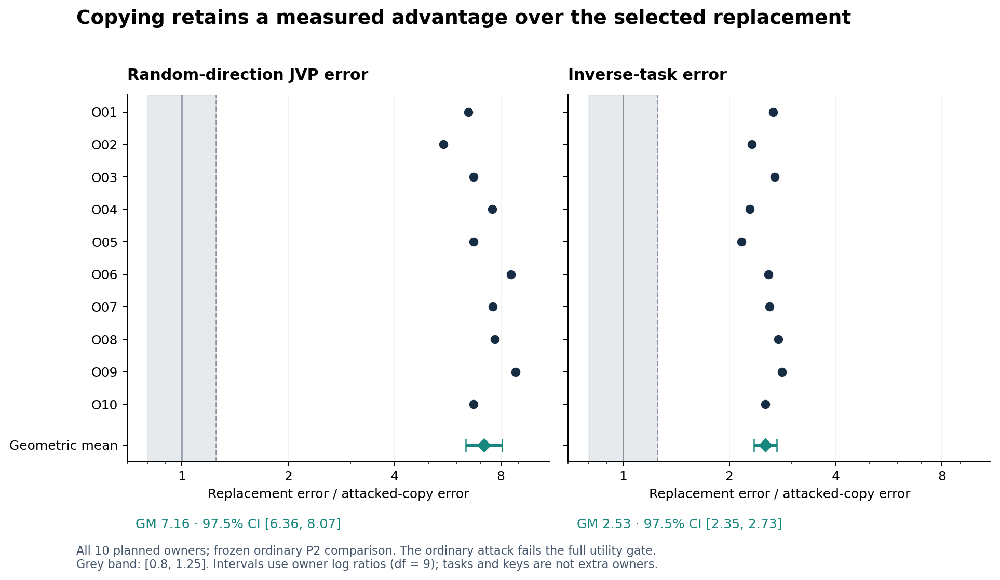
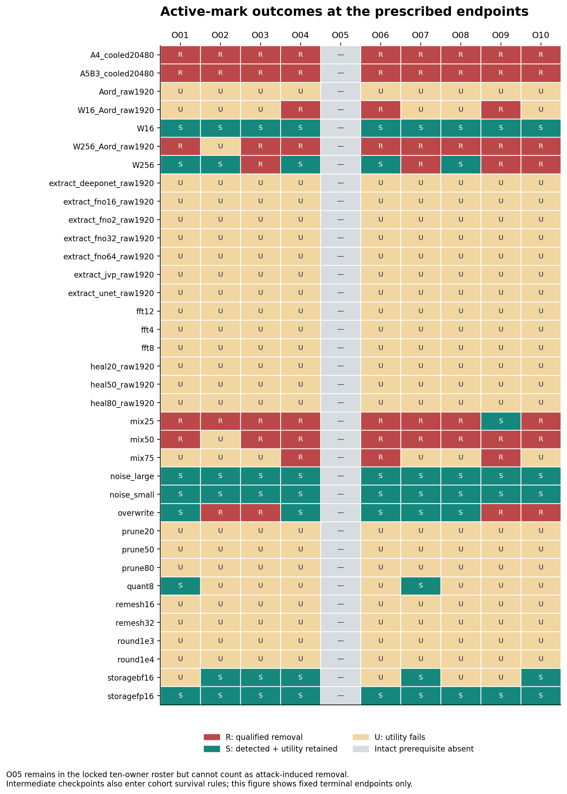
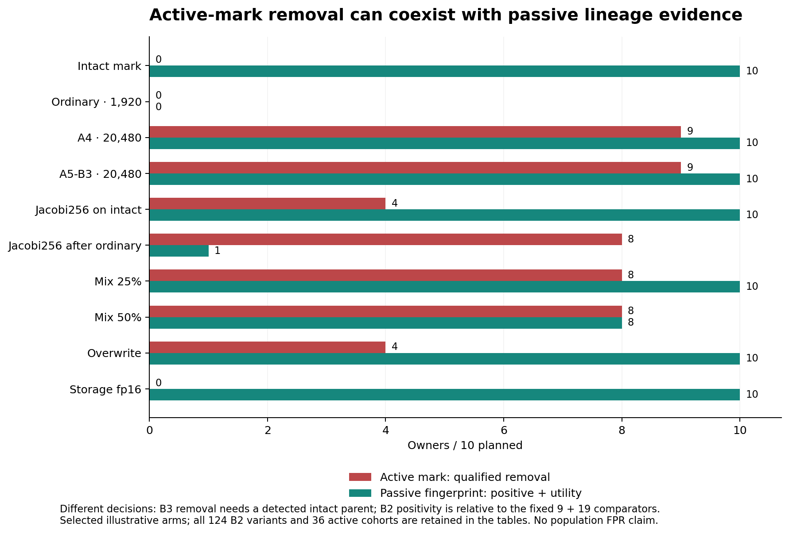
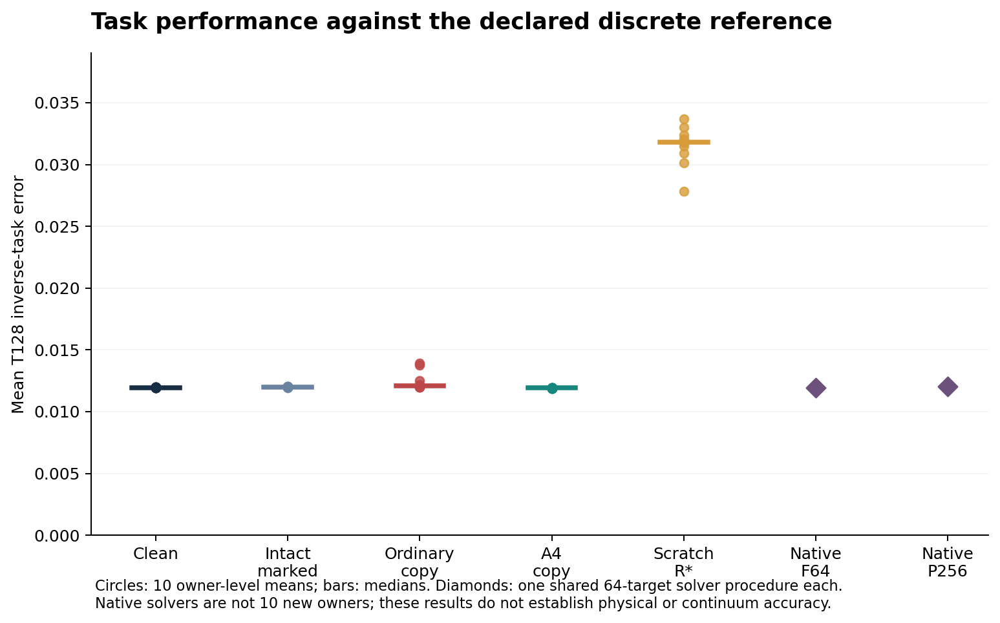

# OperatorMark | Final scientific analysis

Hadi Chamas · 25 October 2026 · Public release candidate 1.0.0-rc5

**Ownership evidence depends on attacker access, checkpoint and utility definition.** Early ordinary fine-tuning gives useful active removals with positive passive evidence. Larger derivative-labeled data also give useful removals while B2 stays positive. Jacobi correction after the ordinary primary instead defeats both evaluated tests with full utility for seven owners. The frozen copy-versus-scratch comparison remains unchanged.

| Finding | Observed result |
| --- | --- |
| Ordinary 320, descriptive | Detection 0/10; full utility 9/10; qualified removal 8/10; B2+utility 9/10 |
| Ordinary 960, descriptive | Detection 0/10; full utility 5/10; qualified removal 4/10; B2+utility 5/10 |
| Ordinary 1,920, frozen primary | Detection 0/10; full utility 0/10; qualified removal 0/10; copy advantage ratios 7.16 for JVP and 2.53 for task |
| A4 and A5-B3, 20,480 endpoint | Qualified removal 9/10 planned for each; utility and B2+utility 10/10; O05 intact prerequisite absent |
| Jacobi256 after ordinary 1,920 | Full utility and qualified removal 8/10; seven useful copies defeat both evaluated tests; B2 cohort remains mixed |
| Fixed keyed nulls / adaptive accuser | 0/210 fixed null detections; 0/10 adaptive detections; no population FPR guarantee |
| Remaining campaign computation | No additional Colab run is on the adopted numerical-work list |

These are bounded empirical findings, not an unremovable-watermark claim, a universal impossibility theorem, a legal ownership determination, or physical/continuum qualification. The selected replacement is one fixed procedure; its result is not a bound on every possible scratch model.

This report presents the saved-result synthesis. The accompanying repository reproduces the statistical readout from compact observations; it does not independently regenerate the full training campaign. The author read-through is complete and publication-format preprint v0.4 is prepared. The public repository is [https://github.com/Hc1012/OperatorMark](https://github.com/Hc1012/OperatorMark), with rc5 as the initial public artifact deposit. The preprint is not submitted or publicly deposited, its license remains undecided, and the main announcement is pending. Historical failed and deferred obligations remain visible. No training, solver, GPU experiment, new benchmark measurement or paid launch was performed during this analysis.

Evidence: analysis/expected/FINAL_ANALYSIS.json; provenance/PRIOR_ANALYSIS_VALIDATION.json; provenance/CLAIM_EVIDENCE_INDEX.json. Original file/member hashes identify the retained private records; an original-archive pointer does not imply that archive is publicly available. All subsequent evidence pointers name either a public input or an original private source record. See DATA_AVAILABILITY.md.

## 1. Population, measurements and fixed decisions

The scientific cohort is O01-O10 (N = 10), with resource fraction kappa = 0.25. B10 is the single shared 10%-data baseline evaluated in O01 context, not an eleventh owner; it is excluded from keyed nulls and B2 groups. The analysis preserves 851 unconditional full evaluations plus 20 noise evaluations, and 400 separate intermediate diagnostics. The latter are not full task evaluations. There are 128 distinct model-variant labels, 124 evaluated by B2 (excluding B10, O, Rraw1920 and Rstar), and 36 active marked-parent procedure cohorts that may each contain multiple checkpoint labels. B10 occurs only in O01, explaining 1,271 rather than 1,280 compact observations. These are different groupings, not missing jobs.

d0 is model-to-model output discrepancy; d1 is model-to-model derivative discrepancy; dcap concerns downstream capability under fixed constraints and budgets. In this campaign, F, J and K are forward, random-JVP and keyed-JVP errors against the declared numerical reference. T is inverse-task error from independently solver-scored saved designs; P256 is the second discrete scoring path. These errors are not automatically d0 or d1 between two models. The primary compares their errors, not model equivalence in every sense.

The immutable utility rule requires each F/J/K/T error to be finite, nonnegative and at most 1.25 times the original clean owner on the same final test. P256 is reported separately; it is not silently substituted into that four-component gate. Detection requires the true score to exceed both the frozen owner theta and the largest absolute wrong-key score plus delta. There are 4,095 wrong keys per score grid.

The pre-attack qualification roster contains all ten owners. On the final test all ten intact marks pass utility, but O05 is not detected. The locked denominator is still ten. Removal attributable to an attack therefore requires a further same-test intact prerequisite; O05 cannot be counted. Reporting 9/9 as though the planned cohort had changed would conceal this limitation.

| Owner | Intact detected | J ratio R*/copy | T ratio R*/copy |
| --- | --- | --- | --- |
| O01 | Yes | 6.4763 | 2.6630 |
| O02 | Yes | 5.5040 | 2.3152 |
| O03 | Yes | 6.6906 | 2.6912 |
| O04 | Yes | 7.5619 | 2.2864 |
| O05 | No | 6.7060 | 2.1631 |
| O06 | Yes | 8.5374 | 2.5845 |
| O07 | Yes | 7.5949 | 2.6008 |
| O08 | Yes | 7.6858 | 2.7529 |
| O09 | Yes | 8.8117 | 2.8182 |
| O10 | Yes | 6.6957 | 2.5323 |

Evidence: qualification_current/<owner>/QUALIFICATION.json; FINAL_EVAL_REVIEW_20261019T164654Z.zip::output/evaluations/<owner>/M3/evaluation/RESULT.json; completed_primary/FINAL_CPU_RETURN_VERIFIED.json; frozen routing.py::assess_descendant and orchestration.py::final_descendant_readout.

## 2. Frozen primary: copy versus selected scratch replacement

| Metric | Geometric ratio | 97.5% pointwise interval | 95% equivalence interval |
| --- | --- | --- | --- |
| Random JVP | 7.1630 | [6.3564, 8.0719] | [6.4772, 7.9215] |
| Task | 2.5322 | [2.3506, 2.7277] | [2.3783, 2.6959] |

The ratio is Rstar error / Aord_M3_raw1920 error. All ten owner ratios exceed 1.25 on both endpoints. The frozen rule labels the comparison **copy advantage**: at least one 97.5% lower bound must exceed 1.25 and both must exceed 0.8. Equivalence does not pass; both separate 95% intervals would need to lie entirely inside [0.8, 1.25].

Intervals use Student-t uncertainty on owner log ratios (df = 9), conditional on the shared benchmark and fixed development procedure. The two 97.5% pointwise intervals give nominal joint coverage at least 95% under that model. The two 95% equivalence intervals are an all-components test, not simultaneous 95% coverage. Tasks, repeated directions and keys do not increase N. No owners were dropped, and no new primary was chosen from attack outcomes.

Rstar is the prospectively selected cooled 10,240-update replacement endpoint; the copy endpoint is 1,920 updates. Equal information is not equal training compute. The primary does not show that ordinary copying preserved the original clean owner utility: every ordinary marked copy fails J and K, five fail F, none fails T. Both prespecified joint ordinary-P2 headlines (copy advantage plus qualified removal; copy advantage plus retained detection/utility) are false. The stronger A4/A5 results are not substituted into this primary.

Evidence: ORDINARY_CPU_RETURN_REVIEW.zip::merged/<owner>/{Rstar,Aord_M3_raw1920}/RESULT.json; FINAL_ANALYSIS.json#/primary and /cohorts/ordinary_P2_joint; pinned analyze.py::interval, quality_label.

### Retained ordinary checkpoints and utility-definition sensitivity

Ordinary raw320 and raw960 are final-domain, task-measured saved endpoints, not D2 diagnostics. Detection is 0/10 at both. Raw320 gives utility 9/10 and qualified removal 8/10; O04 fails J/K and O05 is useful but lacks intact detection. Raw960 gives utility 5/10 and qualified removal 4/10. B2 is positive for all ten at both checkpoints, including every useful copy. These descriptive results do not replace raw1920 as primary, establish an optimal stopping policy, or change its failed joint headline.

At raw1920, J/K fail all ten, F fails five and T passes all ten. Explicitly **post-hoc** tallies retaining the intact prerequisite and active rule give 9/10 removals under T-only utility, or 5/10 under F+T utility (O01, O04, O07, O09, O10). The adopted F/J/K/T count remains 0/10. Close finite-budget task results do not establish a certified task floor or general derivative insensitivity.

Evidence: `FINAL_ANALYSIS.json#/variants/Aord_M3_raw{320,960,1920}`, corresponding `B2` entries, and `model_readouts/<owner>/<variant>`. Original source: `ORDINARY_CPU_RETURN_REVIEW.zip::merged/<owner>/<variant>/RESULT.json`.

## 3. Active TangentMark: every prescribed terminal cohort

Counts below use all ten planned, earlier-qualified owners. "Retained" means detection AND all utility gates, with a detected useful intact parent. The formal cohort label "mixed" can mean universal utility failure; it does not imply that some removals succeeded. Survival additionally checks every prescribed intermediate checkpoint. Terminal endpoints are chosen by the frozen schedule, not by observed performance.

| Terminal variant (M3 parent) | Det. | Util. | Rem. | Ret. | Cohort |
| --- | --- | --- | --- | --- | --- |
| A4_cooled20480 | 0 | 10 | 9 | 0 | removed |
| A5B3_cooled20480 | 0 | 10 | 9 | 0 | removed |
| Aord_raw1920 | 0 | 0 | 0 | 0 | mixed |
| W16_Aord_raw1920 | 0 | 3 | 3 | 0 | mixed |
| W16 | 9 | 10 | 0 | 9 | survives (tested) |
| W256_Aord_raw1920 | 0 | 8 | 8 | 0 | mixed |
| W256 | 5 | 10 | 4 | 5 | mixed |
| extract_deeponet_raw1920 | 0 | 0 | 0 | 0 | mixed |
| extract_fno16_raw1920 | 0 | 0 | 0 | 0 | mixed |
| extract_fno2_raw1920 | 0 | 0 | 0 | 0 | mixed |
| extract_fno32_raw1920 | 0 | 0 | 0 | 0 | mixed |
| extract_fno64_raw1920 | 0 | 0 | 0 | 0 | mixed |
| extract_jvp_raw1920 | 0 | 0 | 0 | 0 | mixed |
| extract_unet_raw1920 | 0 | 0 | 0 | 0 | mixed |
| fft12 | 9 | 0 | 0 | 0 | mixed |
| fft4 | 9 | 0 | 0 | 0 | mixed |
| fft8 | 9 | 0 | 0 | 0 | mixed |
| heal20_raw1920 | 0 | 0 | 0 | 0 | mixed |
| heal50_raw1920 | 0 | 0 | 0 | 0 | mixed |
| heal80_raw1920 | 0 | 0 | 0 | 0 | mixed |
| mix25 | 1 | 10 | 8 | 1 | mixed |
| mix50 | 0 | 8 | 8 | 0 | mixed |
| mix75 | 0 | 3 | 3 | 0 | mixed |
| noise_large | 9 | 10 | 0 | 9 | survives (tested) |
| noise_small | 9 | 10 | 0 | 9 | survives (tested) |
| overwrite | 5 | 10 | 4 | 5 | mixed |
| prune20 | 0 | 0 | 0 | 0 | mixed |
| prune50 | 0 | 0 | 0 | 0 | mixed |
| prune80 | 0 | 0 | 0 | 0 | mixed |
| quant8 | 6 | 2 | 0 | 2 | mixed |
| remesh16 | 0 | 0 | 0 | 0 | mixed |
| remesh32 | 4 | 0 | 0 | 0 | mixed |
| round1e3 | 0 | 0 | 0 | 0 | mixed |
| round1e4 | 0 | 0 | 0 | 0 | mixed |
| storagebf16 | 9 | 6 | 0 | 5 | mixed |
| storagefp16 | 9 | 10 | 0 | 9 | survives (tested) |

A4 uses normalized forward-plus-half-JVP training; A5-B3 adds the public projection penalty. Both use the 16,384-control reference group, whereas ordinary training uses 256 forward-labeled controls. The 16,384 controls are four times the owner-training count of 4,096. At 20,480, every saved F/J/K/T error is lower than its own clean-owner value for all ten owners in both attacks. There is no matched-access scratch comparison, so the benefit of the acquired initialization at that access is unknown. The access and update budgets differ; these outcomes do not isolate the derivative term, identify a minimum necessary dataset or establish economic benefit. At 1,280 updates A4 gives 8 qualified removals and A5-B3 gives 5. At both 5,120 and 20,480, each gives 9/10 qualified removals and all ten pass utility. These tested checkpoints do not identify the earliest possible removal time or minimal attack cost. A4 already succeeds without the additional A5-B3 penalty; this does not establish a necessity claim for that penalty.

Evidence: FINAL_ANALYSIS.json#/cohorts; ATTACKS_CPU_RETURN_REVIEW.zip::merged/<owner>/<variant>/RESULT.json; source msdev/kernels.py::loss_with_scales. Complete intermediate counts remain in the JSON and ALL_VARIANT_TABLES.md.

## 4. Owner-level active-mark outcomes

## 5. Active marking and passive lineage are different

B2 compares a descendant against its own original clean owner, nine matched descendants from other owners and nineteen fixed controls (nine other clean owners and ten selected replacements). It embeds nothing. A strictly positive margin means the own-owner distance is smaller than every fixed comparator distance. This is a finite comparison rule, not a calibrated population ownership probability, p-value or false-positive rate. No exchangeable, tie-free null is established. B2 uses the first 128 of the final 512 metric controls with their same two directions; it is not an independent held-out sample from the metric evaluation. All 28 comparators remain: marginal reference-error medians do not prove any comparator unable to bind.

At the terminal A4 and A5-B3 marked endpoints, B2 is positive and utility-preserving for all ten owners even though B3 detection is absent. This shows positive passive evidence at those particular useful-removal endpoints, not general passive robustness. By contrast, the ordinary marked endpoint has B2 positive for only 3/10 and utility for 0/10. The A5-B2 method-aware attacks on clean owners produce B2 nonpositivity in all ten at each endpoint, but none passes the full utility gate; that is not utility-preserving passive evasion.

Across all 124 B2 variants the frozen classifier gives 34 retained and 90 mixed, with none meeting its cohort-level evasion rule. This must not obscure individual joint failure. For Jacobi256 after ordinary marked 1,920 fine-tuning, **O01, O03, O04, O07, O08, O09 and O10 pass full utility, qualify as active removals and have nonpositive B2**, with strictly negative saved margins. O06 passes utility/removal but remains B2 positive; O02 and O05 fail utility. Both evaluated tests therefore fail with full utility for seven planned owners. This does not establish that every possible signal of descent is erased.

The Jacobi cohort remains mixed because only eight owners pass utility, below the required nine. "Retained" in the B2 source rule is driven by positivity; utility counts must be read separately. The aggregate 358/1,240 positive rows is not a robustness rate over a sampled attack distribution. Jacobi256 adds 256 numerical iterations per forward call; its smaller labeled training set does not prove lower total cost than derivative-aware training.

Evidence: FINAL_ANALYSIS.json#/B2; NULL_B2_ANALYSIS_INPUTS.json (preserved inside SUPPLEMENT_ANALYSIS_INPUTS.json); original NULL_B2_REVIEW_20261024T231513Z.zip::output/b2/<owner>/<variant>.json; rules.py::b2_cohort.

## 6. Students, transformations and deliberate missing tasks

Seven student methods cover same-FNO distillation, narrower and wider FNOs, the FNO2 variant, DeepONet, U-Net and victim-JVP extraction. Their 140 training jobs, 268,800 updates and 420 checkpoints remain completed work. The 140 terminal evaluations cover clean and marked teachers. None of the seven marked student endpoint cohorts has a qualified removal or retained-detection-with-utility success. This is a failure of the tested procedures/budgets, not a claim that all architectures or longer training must fail. Budget-limited endpoints are not convergence proofs: historical development D1 was still improving at its 81,920-update cap, and its single extension was exhausted.

The D2 rule was fully applied to 400 raw320/raw960 diagnostics in 20 comparison cells. No extra task cell was selected. All 200 marked D2 intermediate candidates are undetected and fail F/J/K. For 180, measured failures settle both outcomes for every possible T; the other 20 belong to O05 and already lack the intact prerequisite. T and P256 remain **unmeasured**, not zero or failed. The raw960 cross-attempt evidence uses the saved results-only adapter; original labels and records were not rewritten.

Pruning/healing, Fourier filtering, rounding and remeshing generally lose useful behaviour under the tested settings; their detailed F/J/K/T gate failures are retained in the variant table. Quant8 and bf16 retain useful detection for only subsets; fp16 retains it for nine attributable owners. Jacobi correction, mixing and overwriting yield partial removals rather than a single uniform outcome. The 256-step wrapper after ordinary fine-tuning gives eight qualified removals; on the intact mark it gives four removals and five useful detections.

The historical equal-loss healing journals remain a methodological concern. Saved weight observations report the intended nested pruning counts, zero values at reconstructed pruned positions and distinct tensor values in all 60 pair comparisons. That resolves the suspicion of identical saved tensors, not the causal reason for equal journals. The terminal utility failures remain negative evidence. Earlier weight archive finalization failed after successful scoring; the separately verified results-only merge is reused without rescoring.

Noise follows its adopted additive white-box pathwise contract: the detector and derivatives use the un-noised base, so it cannot establish stochastic black-box mark removal. Both amplitudes retain useful detection for the nine attributable owners; all ten pass utility. The clean-parent noise and API rows were explicitly omitted, not lost. No curves are interpolated through missing D2 task outcomes.

Evidence: STUDENTS_CPU_RETURN_REVIEW.zip; WEIGHTS_CPU_RETURN_REVIEW.zip::batch/*/D6_REQUEST.json plus WEIGHTS_CPU_MERGE_VERIFIED.json; TRANSFORMS_CPU_RETURN_REVIEW.zip; OPERATOR_MARK_NATIVE_D2_RESULTS_20261024.zip::d2_selection; WEIGHT_OBSERVATIONS_AND_CLOSURE.json; NOISE_CPU_RETURN_REVIEW.zip::groups/NOISE/merged/*/*/RESULT.json.

## 7. Native solver challengers and task context

| Native procedure | Mean T128 error | Mean P256 error | Targets |
| --- | --- | --- | --- |
| F64 | 0.01191074 | 0.01183016 | 64 |
| P256 | 0.01201047 | 0.01200246 | 64 |

These are two shared 64-target inverse-design procedures, not twenty owner-specific replicas. Their reported totals are 31,104 native calls and 15,360 individual inverse updates across 128 targets. The model task means use the same target benchmark, with saved designs scored through both numerical paths. The selected scratch model has a much larger task error than the copies. Near-equal native and owner-level task errors do not establish a global optimum, irreducible error floor, general derivative insensitivity or an absolute engineering adequacy threshold.

B10 has F = 0.010564, J = 0.119321, K = 0.116059, T = 0.018585 and P256 = 0.019122 in its one O01 context; it fails all four relative utility gates there. It is a contextual data-budget baseline, not an independent ten-owner inferential comparison.

F64 means the declared T128-to-64 discrete reference. P256 supplies a different numerical path. Q1-Q4 physical qualification was negative; the present task is the narrower box-constrained inverse problem, not the original physically qualified topology-optimization programme. Cross-reference agreement cannot repair that distinction.

Evidence: NATIVE_F64_P256_RETURN_20261024T072602Z.zip::output/{F64,P256}/RESULT.json; MODEL_ANALYSIS_INPUTS.json#/O01/B10; historical handover sections 3 and 4.3.

## 8. Fixed nulls, adaptive accusation and API policies

The final keyed-null block has **zero detections in 210 fixed cases**: per owner, nine other clean models, ten selected scratch replacements, one own sham and F64. B10 is excluded. F64 uses the completed reference tangent supplement; the existing catalogue and older truth/tangent arrays remain preserved. The observed zero is not a population false-positive bound: keys, owners and controls are shared, and the cases are dependent.

The fixed adaptive-accuser procedure produces zero detections in ten final readouts. It uses its own retained calibration/reference/normalizer and a key chosen before its final readout, not defender calibration. This remains evidence about that procedure and scope. Earlier raw adaptive score grids were absent from the compact review; saved readouts and prior verification are reused. No universal resistance to adaptive false accusation follows.

| API policy | Streams / attempts | Actual responses |
| --- | --- | --- |
| cache | 10 / 10,240 | cached: 5,120; computed: 5,120 |
| paired_deny | 10 / 10,240 | computed: 5,120; denied_near_previous: 5,120 |
| rate | 10 / 10,240 | computed: 471; denied_rate: 9,769 |

The API block measures 30 persistent streams, each with 1,024 ordered attempts. Cache and paired-denial policies each compute half their requests. The rate-limited service computes 471 and denies 9,769 across owners; these are retained observed outcomes, not a count inferred from its schedule. These service results provide no J/K/T, B2 or B3 decision, and no black-box removal conclusion. No API CPU-scoring stage is missing.

Evidence: FINAL_ANALYSIS.json#/nulls, /adaptive, /API; API_REVIEW_20261024T140425Z.zip::output/owners/*/*/REVIEW.json; ADAPTIVE_CALIBRATION_SCOPE_REVIEW.json; null/B2 verified report. The null/B2 producer reports 19,840 JVP batches and 317,440 directions; its work was not rerun for this analysis.

## 9. Earlier results remain separate evidence

| Study / evidence class | Retained conclusion |
| --- | --- |
| TPFA32 ten-owner study; saved analysis inspected | Qualified removal 10/10, null detections 0/190. JVP ratio 1.1499 [1.0919, 1.2109]; task ratio 0.9088 [0.7087, 1.1654]. Frozen label: trade-off/inconclusive. Equivalence also failed. |
| Q1-Q4; historical reports reused | Negative physical qualification; internal finite-difference checks passing did not establish physical adequacy. No new qualification run is proposed. |
| Original marking search; historical report | 0/18 qualification is preserved. B1 remains failed/unavailable; no two-working-active-watermark claim. |
| Corrected D3 replay; saved outcome | Three endpoints reproduced bitwise in 960 updates. Descriptive noise classification did not uniquely identify cause or qualify the original marks. |
| P-N; saved outcome | Global-mean marking penalty; nine candidates. All passed utility, only factor 3 qualified 3/3. The other six negative candidates remain. |
| Marked development closure; historical reported result | All three marks lost detection, all failed J/K utility; qualified removal 0/3. Clean-owner attacks also lost derivative utility. |

The current S128 copy-advantage result does not revise the earlier TPFA32 trade-off/inconclusive result. They differ in models, numerical setting, procedures, replacement schedules and gates. The TPFA32 R-a replacement used 16,896 updates and had weak-owner/additive-slack limitations; the present Rstar endpoint is 10,240. Their owner populations and null counts must never be pooled into a larger sample.

A credible contribution can contain all of these outcomes: qualified removal in one study, failed initial marking in another, successful revised marking, unqualified detection loss, and qualified stronger attacks. The common question is what a specified attacker can preserve and what each detector actually identifies. TangentMark failing some attacks does not invalidate OperatorMark.

Evidence: historical_evidence/analysis.review.json and companion RESULTS/QUALIFICATION; historical_evidence/D3_OUTCOME.json and PN_OUTCOME.json; original handover PROJECT_HANDOVER.txt sections 4.2-4.8 and EVIDENCE_GUIDE.txt E02-E10. Underlying historical experiments were not repeated.

## 10. Measured work and resource limits

| Completed evaluation block | Requests | CPU score hours |
| --- | --- | --- |
| Primary | 20 | 0.524 |
| Ordinary and controls | 91 | 2.365 |
| A4/A5 | 120 | 3.049 |
| Terminal students | 140 | 3.591 |
| Weights and healing | 200 | 5.206 |
| Transforms | 200 | 4.965 |
| Jacobi16 | 40 | 1.041 |
| Jacobi256 | 40 | 1.041 |
| Noise | 20 | 0.528 |
| Total | 871 | 22.308 |

This is summed recorded CPU scoring time for the 871 completed full/noise model evaluations, not wall-clock project duration or a cloud bill. Each evaluation scores 64 saved designs through both references: 55,744 T128 and 55,744 P256 scoring calls in this subtotal. Native inverse challengers, training monitors, reference preparation, D2 diagnostics and the null supplement are separate populations/work; they are not counted as more full model evaluations.

The last null/B2 stage records 35.95 producer minutes and 46.18 minutes from activation through main-publisher closure. At the recorded 5.3 units/hour this is a 4.079-unit proxy, not an invoice; preactivation connection and final metadata publication are excluded.

The retained student training subtotal is 140 jobs, 268,800 completed updates and 420 endpoints. These counts describe substantial completed work, not a denominator for whole-project percentage. Failed attempts, setup, waiting for GPUs, downloads, earlier development and idle connections are not fully reconciled into a monetary total here. No honest total project spend or reliable completion percentage can be recovered from the present cost records.

Measured task cost and equal information do not imply equal training compute, equal hardware time or equal financial cost. Report raw schedules, query access, per-stage work and recorded durations separately. The historical clean-wave estimate was not the cost of the complete campaign or a spending authorization. Nothing in this analysis starts a clock or requires a top-up.

Evidence: MEASURED_COSTS.json, which records each source filename and field; prior CPU return verifications; latest NULL_B2_RETURN_VERIFIED_20261024T231513Z.json#/timing.

## 11. Limits, amendments and the actual finish line

The supported claim is a conditional empirical separation across access and checkpoints: early ordinary fine-tuning and derivative-aware training give useful active removals with positive B2; Jacobi256 after ordinary 1,920 instead gives seven useful copies that defeat both tested signals. The unchanged primary establishes a reference-error advantage over one selected scratch procedure. The programme establishes neither universal watermark robustness or lineage erasure, a minimal removal budget, nor equivalence of all copied and scratch operators.

The cohort has ten owners sharing one benchmark and development selection procedure. Its conditional log-ratio model is not external replication. The secondary attack tables are descriptive and span many correlated choices; no additional confirmatory significance claims are made from selecting favourable rows. The same-test O05 failure, all intermediate checkpoints, and all failed utility gates remain.

D7 historical exclusion coverage is incomplete. D8 was adopted after generation and observation of 76 relaxed anomalies. The two completed scientific readbacks and sealing are reused, while physical verdicts, formal production acceptance and exclusive custody remain unclaimed. These limitations belong in any public paper, not only an appendix.

The original 130 contract slots were deliberate future bindings. The later accepted FINAL_CONTRACT_BINDINGS.json now records all 130 bound, with non-null fields unchanged. This is distinct from the 50 deliberately omitted O-parent noise/API measurements, the 400 unmeasured D2 tasks, and the conditional scientific obligations. No values are invented to fill those deliberate omissions.

Conditional/untriggered items remain buyer collusion, same-data ordinary controls, the 1,024-query ordinary tier, scratch-R4 solver attribution, training through wrappers, disjoint B0, black-box derivative protocols and N16. The original physical topology-dcap obligation remains unfulfilled/conditional. Formal E3, N0/N1, host/provider/exclusive-custody and production assurance are explicitly deferred or unsatisfied. Historical S1/S2 passes do not transfer to changed code; S3_01 failure is preserved.

Analysis is complete for the adopted numerical evidence. This release supplies the compact observations, analysis, source snapshot and methods documentation. The public repository now exists. Paper submission/deposit, the paper license and the main announcement remain pending. No new experiment is needed merely to make the existing logs tidier. Any later extension must be described as a new study, not silently inserted into this locked result.

This report is not a formal acceptance record and does not advance the canonical Windows worker. Existing complete_programme/scientific_acceptance/custody flags are preserved, even where later results supersede dated pending-work text. There is no material contradiction among the numeric conclusions assembled here; O05 qualification versus final detection and historical pending flags are differences of scope/time, not evidence to erase.

## 12. Reproducibility and evidence map

The companion private bundle contains the full analysis JSON, 1,271 compact model observations with original source/member/hash pointers, supplemental null/native/API/qualification inputs, all variant tables, measured-cost and scope records, the frozen graph and pinned statistical functions, and four figures in PNG/SVG/PDF. It preserves selected earlier results without duplicating multi-gigabyte model or corpus archives.

Run `python3 analyze_saved_results.py` inside the extracted bundle to recompute the statistical/gate readout from its saved inputs. The analysis imports no training or solver modules. `make_figures.py` rebuilds the plots. `assemble_inputs.py` documents the original evidence extraction and requires the named existing source archives. New local analysis code is separate from the 338 frozen scientific source pins. Runtime versions and verification details are in ANALYSIS_VALIDATION.json.

| Claim | Primary machine-readable pointer |
| --- | --- |
| primary_copy_advantage | FINAL_ANALYSIS.json#/primary |
| intact_O05_not_detected | FINAL_ANALYSIS.json#/intact/O05 |
| ordinary_checkpoint_dependence | FINAL_ANALYSIS.json#/variants/Aord_M3_raw{320,960,1920} and matching B2 entries |
| Jacobi_joint_test_failure | FINAL_ANALYSIS.json#/model_readouts/<owner>/W256_Aord_M3_raw1920 and /B2/W256_Aord_M3_raw1920/rows |
| qualified_removal_A4_A5 | FINAL_ANALYSIS.json#/cohorts/cohorts/{A4_M3,A5B3_M3} |
| B2_lineage | FINAL_ANALYSIS.json#/B2 |
| fixed_keyed_nulls | FINAL_ANALYSIS.json#/nulls |
| D2_deliberately_unmeasured | FINAL_ANALYSIS.json#/D2 |
| native_tasks | FINAL_ANALYSIS.json#/native |
| API_only_observed_service | FINAL_ANALYSIS.json#/API |
| adaptive_accuser | FINAL_ANALYSIS.json#/adaptive |
| earlier_TPFA32 | HISTORICAL_CONTEXT.json#/TPFA32 |
| physical_and_provenance_limits | EVIDENCE_CONTEXT.md |
| bound_130_contract_slots | SCOPE_AND_DISPOSITIONS.json |
| costs | MEASURED_COSTS.json |

Inspected evidence means supplied record bytes were read; historical operations remain reported operations unless independently replayed. This analysis did not independently reproduce raw model execution or rehash absent large Drive binaries. Prior closure/readback records are historical evidence, not a live-process check. The latest separate metadata publisher lacks supplied machine-readable closure; its screenshot status is weaker evidence. None of those boundaries is promoted into formal custody assurance.

Use CLAIM_EVIDENCE_INDEX.json for original filenames and record/field pointers, MODEL_ANALYSIS_INPUTS.json for per-observation provenance, and EVIDENCE_CONTEXT.md for assurance/supersession details. Keep underlying completed returns and negative records. Public artifact deposition is not permission to delete the underlying completed returns or private source evidence.
